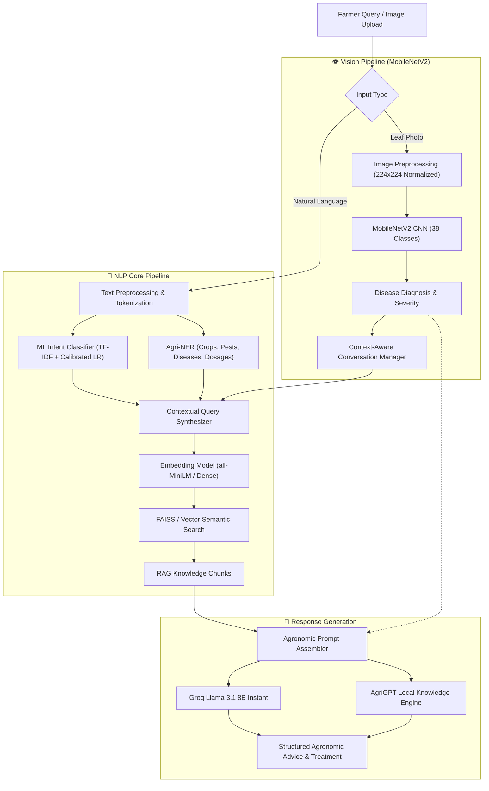

# 🌾 AgriGPT: AI Agricultural Advisory & Plant Pathology System

[](https://www.python.org/downloads/)
[](https://streamlit.io)
[](https://pytorch.org)
[](https://groq.com)
[](#nlp-as-central-technology)

**AgriGPT** is an intelligent, domain-adapted agricultural advisory platform designed to assist farmers, agronomists, and researchers. Natural Language Processing (NLP) serves as the core foundation, powering query understanding, entity extraction, semantic retrieval, and conversational reasoning—seamlessly integrated with deep computer vision for plant foliar disease detection.

---

## 🏛️ System Architecture



---

## 🔬 NLP as the Central Technology

Natural Language Processing drives the entire reasoning cycle of AgriGPT:

1. **Text Preprocessing & Normalization (`src/nlp/preprocessor.py`)**:
   - Expands English agricultural contractions (`what's`, `can't`).
   - Normalizes unicode characters and standardizes agricultural units (`kg/ha`, `ml/L`, `pH`, `19-19-19`, concentrations).
   - Domain-specific tokenization preserving compound agricultural names (e.g. `late-blight`, `yellow-rust`).
   - Agricultural stopword filtering retaining condition indicators, negations, and measurement terms.
   - Domain morphological lemmatization for agricultural terminology (`leaves` → `leaf`, `rotting` → `rot`, `wilting` → `wilt`).

2. **ML-Based Intent Classification (`src/nlp/intent_classifier.py`)**:
   - Employs a **TF-IDF Vectorizer** (unigram + bigram, sublinear scaling) coupled with a **Calibrated Logistic Regression** classifier.
   - Categorizes user inputs across 8 distinct agricultural intents:
     - `disease_diagnosis`
     - `pest_control`
     - `fertilizer_soil_management`
     - `irrigation_water_management`
     - `crop_selection_cultivation`
     - `weather_climate_advice`
     - `market_price_economic`
     - `general_greeting_help`
   - Generates confidence scores and full probability distributions.
   - Automatically serialized to disk at `models/intent_classifier.joblib`.

3. **Domain Named Entity Recognition (Agri-NER) (`src/nlp/ner_extractor.py`)**:
   - Identifies and normalizes 7 categories of agricultural entities:
     - **CROPS**: Tomato, Potato, Wheat, Rice, Cotton, Maize, Apple, Grape, Chilli, etc.
     - **DISEASES**: Early Blight, Late Blight, Yellow Rust, Bacterial Blight, Scab, etc.
     - **PESTS**: Aphids, Whitefly, Stem Borer, Bollworm, Thrips, Spider Mites, Armyworm, etc.
     - **FERTILIZERS & CHEMICALS**: Urea, DAP, NPK 19-19-19, Mancozeb, Copper Oxychloride, Imidacloprid, etc.
     - **SOIL TYPES**: Black Soil, Alluvial / Sandy Loam, Clay Soil, Red Soil, Saline Soil, etc.
     - **GROWTH STAGES**: Germination, Vegetative, Flowering, Fruiting, Maturity.
     - **METRIC QUANTITIES & DOSAGES**: `2.5 g/L`, `50 kg/acre`, `pH 6.5`, `25 DAS`, `100 mg/L`.

4. **Embeddings & Vector Store (`src/nlp/embeddings.py`, `src/nlp/vector_store.py`)**:
   - Uses dense normalized embeddings with `SentenceTransformers` (`all-MiniLM-L6-v2`) and a zero-downtime offline TF-IDF projection fallback.
   - Indexed using **FAISS** (Facebook AI Similarity Search) inner-product cosine similarity.
   - Supports hybrid filtering by detected crop, category, and keyword boosts.

5. **Retrieval-Augmented Generation (RAG) (`src/nlp/rag_engine.py`)**:
   - Binds query analysis, intent signals, and NER entities into precision knowledge retrieval.
   - Pulls validated agricultural disease symptoms, causal organisms, chemical management (with exact dosages), and organic/IPM alternatives.

6. **Context-Aware Multi-Turn Conversation (`src/nlp/conversation_manager.py`)**:
   - Preserves state across multi-turn dialogs.
   - Automatically carries over active crop and disease context (e.g., if a user uploads a tomato leaf or asks about late blight, subsequent queries like *"what fungicide should I spray?"* immediately recognize the crop is Tomato without the user needing to repeat it).

---

## 👁️ MobileNetV2 Plant Disease Detection

AgriGPT implements a genuine deep learning computer vision model built with PyTorch and `torchvision`:
- **Architecture**: `MobileNetV2` with inverted residual blocks and linear bottlenecks, optimized for high accuracy on foliar pathology.
- **Classes**: 38 standard plant pathology classes spanning Apple, Tomato, Potato, Corn, Grape, Bell Pepper, Peach, Strawberry, Cherry, and healthy foliage.
- **Transforms**: Resize(256), CenterCrop(224), ImageNet RGB normalization.
- **Output**: Predicted class, crop, condition, confidence percentage, severity rating (`None`, `Low`, `Moderate`, `Severe`), and integrated chemical/biological treatment recommendations.
- **Chat Integration**: One-click transfer of vision diagnosis into conversational state.

---

## 🦙 Groq Llama 3.1 8B Instant & Local Engine

- **Model**: `llama-3.1-8b-instant` via the Groq API.
- **Ultra-low latency**: Sub-second generative answers for farmer interactions.
- **Local Fallback Engine**: If no `GROQ_API_KEY` is provided or network is offline, AgriGPT automatically transitions to its internal agronomic synthesis engine, ensuring zero downtime.

---

## 🚀 Installation & Setup

### 1. Clone & Enter Directory
```bash
git clone <repository_url>
cd AgriGPT/aGRIgpt
```

### 2. Create and Activate Virtual Environment
```bash
# Windows
python -m venv venv
.\venv\Scripts\activate

# Linux / macOS
python3 -m venv venv
source venv/bin/activate
```

### 3. Install Dependencies
```bash
pip install -r requirements.txt
```

### 4. Configure Environment (Optional for Groq Cloud LLM)
Copy `.env.example` to `.env`:
```bash
cp .env.example .env
```
Add your free Groq API key:
```env
GROQ_API_KEY=gsk_your_groq_api_key_here
```
*(You can also enter your API key directly inside the Streamlit web application sidebar).*

---

## 🧪 Running Tests

AgriGPT includes a comprehensive test suite validating all NLP components, vision inference, and pipeline integration:

```bash
python -m unittest discover -s tests
```

Output:
```
Ran 9 tests in 0.509s
OK
```

---

## 💻 Launching the Streamlit Application

Start the web application:
```bash
streamlit run app.py
```
Open your browser at `http://localhost:8501`.

### Application Features:
1. **💬 AgriChat**: Multi-turn dialogue with RAG retrieval, source attribution, and active crop context tracking.
2. **📸 Plant Disease Vision Lab**: Drag-and-drop leaf image diagnosis with confidence gauges and treatment cards.
3. **🧠 NLP Explainability Inspector**: Live view of text preprocessing tokens, ML intent classification probabilities, extracted NER tags, and retrieved RAG chunks.
4. **📚 Knowledge Base**: Interactive explorer for agronomic guides, fertilizers, and pest management.

---

## 📁 Repository Structure

```
AgriGPT/
├── app.py                     # Streamlit web application
├── requirements.txt           # Python package requirements
├── .env.example               # Environment variables template
├── README.md                  # Comprehensive documentation
├── data/
│   ├── intents.json           # 8 agricultural intent categories & training patterns
│   ├── entities.json          # Crop, disease, pest, chemical, soil gazetteers
│   └── agri_knowledge_base.json # Domain RAG knowledge documents
├── models/
│   ├── intent_classifier.joblib # Serialized TF-IDF + LogisticRegression model
│   └── mobilenetv2_plant_disease.pt # PyTorch MobileNetV2 weights
├── src/
│   ├── __init__.py
│   ├── pipeline.py            # Master AgriGPT pipeline orchestrator
│   ├── nlp/
│   │   ├── __init__.py
│   │   ├── preprocessor.py    # Text cleaning, normalization, domain tokenization
│   │   ├── intent_classifier.py # ML intent classification & calibration
│   │   ├── ner_extractor.py   # Agricultural Named Entity Recognition
│   │   ├── embeddings.py      # Dense vector representations
│   │   ├── vector_store.py    # FAISS semantic vector search
│   │   ├── conversation_manager.py # Multi-turn context and state tracking
│   │   └── rag_engine.py      # Retrieval-Augmented Generation coordinator
│   ├── vision/
│   │   ├── __init__.py
│   │   └── disease_classifier.py # MobileNetV2 38-class plant pathology model
│   └── llm/
│       ├── __init__.py
│       └── groq_client.py     # Groq Llama 3.1 8B client & local fallback
└── tests/
    ├── test_nlp.py            # NLP unit tests
    ├── test_vision.py         # Vision unit tests
    └── test_pipeline.py       # End-to-end integration tests
```

---

## 🛡️ License & Acknowledgements
- **Dataset Reference**: PlantVillage taxonomy and Indian Council of Agricultural Research (ICAR) package of practices.
- **Models**: Groq Llama 3.1 8B Instant and PyTorch MobileNetV2.
